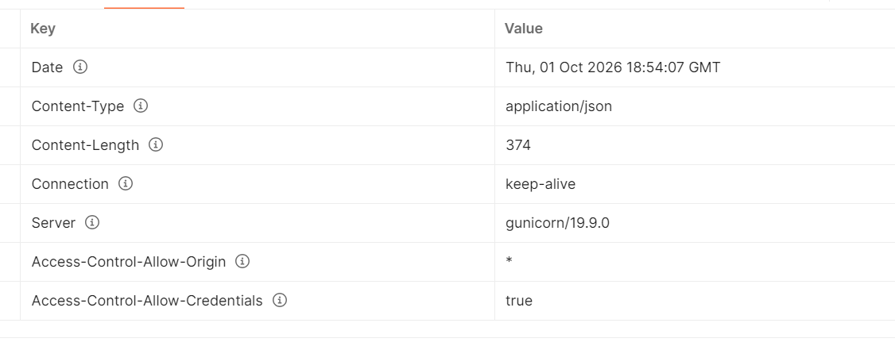

# Week 1: HTTP Basics and Why We Need APIs

**Date:** Thursday, 1 Oct 2026
**Contents:** Part 1 HTTP overview, Part 2 Why APIs (lecture notes), Part 3 practice notes

---

# Part 1: HTTP Overview (Simple Version)

## The big idea
**HTTP is the language computers use to ask for things and get answers on the web.** When you open a website, your browser uses HTTP to ask a server for the page, and the server replies with it.

**Restaurant analogy:** you (browser) place an order, the waiter carries it to the kitchen (network), the kitchen (server) prepares the food, and the waiter brings it back (response).

## 1. Who is involved?

| Player | What it is | Simple meaning |
|---|---|---|
| **Client (user-agent)** | Browser, Postman, or any tool that sends requests | The customer who orders |
| **Server** | The computer that holds and sends back the data | The kitchen |
| **Proxy** | A middleman between client and server | The waiter, or a security guard on the way |

- The **client always starts** the conversation. The server never speaks first.
- A "server" can be many machines sharing the work (load balancing).
- **Proxies** can cache copies, filter content, balance load, check identity, or keep logs.

## 2. Key features of HTTP

- **Simple:** messages are readable text.
- **Extensible:** new information can be added using **headers**, like labels on a parcel.
- **Stateless:** the server doesn't remember you between requests. **Cookies** add memory, so HTTP is *stateless, but not sessionless*.

## 3. What can HTTP control?

- **Caching:** what gets saved and for how long.
- **Authentication:** who is allowed in.
- **CORS (relaxing the origin rule):** lets one website safely read another's data.
- **Proxy and tunneling:** crossing network barriers.
- **Sessions:** cookies remember who you are.

## 4. Connections

HTTP runs on top of **TCP**, so a connection is set up before any request.

| Version | How it handled connections |
|---|---|
| **HTTP/1.0** | New connection for every request (slow) |
| **HTTP/1.1** | Reuses a connection (persistent connections) |
| **HTTP/2** | Many messages at once over one connection (multiplexing) |

## 5. The HTTP flow

1. **Open** a connection
2. **Send** a request
3. **Read** the response
4. **Close or reuse** the connection

## 6. Anatomy of a message

**Request (client sends):** method, path, HTTP version, headers (optional), body (optional)

**Response (server sends):** HTTP version, status code, status message, headers, body (optional)

## 7. Quick example

```
Request:                          Response:
GET /users HTTP/1.1               HTTP/1.1 200 OK
Host: example.com                 Content-Type: application/json

                                  { "name": "Nancy" }
```

## One-line takeaways

- HTTP is a **request and response** system.
- The **client asks, the server answers**.
- It is **stateless**, and cookies add memory.
- **Headers** carry extra information.
- **Status codes** tell you what happened.
- **Proxies** sit in the middle for caching, security and load balancing.

---

# Part 2: Why Do We Need APIs? (Lecture Notes)

## The big idea
The lecture does not explain *what* an API is yet. It explains the **problems that exist without one**, so the definition makes sense next.

**Analogy:** customers can't walk into a restaurant kitchen and cook. They use a **waiter and a menu**. An API plays that role between software systems.

## Key terms

| Term | Simple meaning |
|---|---|
| **Client / Frontend** | What you see on screen (the website UI) |
| **Server / Backend** | Where data is processed and stored (code and database) |
| **Repository** | The folder where a company's code lives |
| **Method (e.g. `createReservation`)** | A piece of backend code that does one job |

## The example: Marriott Hotels

Marriott has its own website (frontend) and backend. When you book a room:
1. You enter city, check-in and check-out dates.
2. The backend checks room availability.
3. It creates a reservation ID and stores it in the database.
4. You can retrieve the booking later.

This works because **frontend and backend are in one repository**, so files can call each other directly.

## Problem 1: Different companies, different codebases

Sites like **hotels.com, MakeMyTrip, Booking.com and Yatra** also sell Marriott rooms. But:
- They need Marriott's live data (rooms left, booking creation).
- That data sits in **Marriott's backend**, owned by a different company.
- Marriott **won't hand over its code** to hundreds of websites.

**Question:** how can hotels.com talk to Marriott's backend without seeing its code?

## Problem 2: Different programming languages

- Marriott's old frontend used **Java**, same as the backend.
- A new frontend uses **Angular (TypeScript)**, while the backend stays in **Java**.
- A TypeScript program **cannot directly call a Java method**. The same is true for Python calling Java.
- Rewriting the whole backend in TypeScript would be a huge effort.

**Question:** how can two systems in different languages communicate?

## Answer (next lecture)
Both problems are solved by an **API**: a **standard way for systems to talk**, without sharing code and regardless of language.

**API = Application Programming Interface**

## Important tips

1. **Learn the "why" before the definition.**
2. **An API is a middleman.** It exposes only what outsiders need and hides the code.
3. **It is language-independent.**
4. **One backend can serve many clients:** a website, a mobile app and partner sites.
5. **QA angle:** you test the API **without seeing the backend code** (black-box). You check what goes in and what comes out.
6. **Remember:** *"Different companies and different languages need a common way to talk. That way is the API."*

---

# Part 3: My Practice Notes (fill in during the session)

## Request I sent in Postman
- Suggested: `GET https://httpbin.org/get`
- Postman is the **client**, httpbin is the **server** whose code I can't see.
- My request:

## Headers I noticed (in the response)
Things to look for, then tick what you actually saw:
- [ ] `Content-Type: application/json`
- [ ] `Content-Length`
- [ ] `Date`
- [ ] `Server`
- [ ] `Access-Control-Allow-Origin` (CORS, from Part 1)
- Others I noticed:
-
